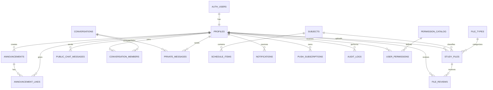

# مخطط قاعدة بيانات تطبيق ممثلي

> **الحالة:** تم تنفيذ المخطط الأساسي والإعدادات التشغيلية على مشروع Supabase بعد المراجعة، مع بقاء الملف قابلاً للتعديل لإضافات التطبيق المستقبلية.
>
> **مبدأ مهم:** كلمات المرور لا تُخزَّن في جداول التطبيق. يتولى `Supabase Auth` حفظها وتحققها، بينما يخزن جدول `profiles` بيانات الحساب العامة وحالة الموافقة والدور.

## 1. الأدوار وحالات الحساب

### الممثل الأعلى

الممثل الذي يسجل بحساب موثق ورقم الهاتف `07723681360` هو الممثل الأعلى للنظام (`super_admin`). لا يكفي الرقم وحده للدخول؛ يجب أن يكون مرتبطاً بحساب Supabase Auth موثق، ولا يجوز عرض الرقم أو الاعتماد على الواجهة لتطبيق هذه الصلاحية. في التنفيذ الأفضل تثبيت هوية الحساب الأعلى بعد إنشاء الحساب والتحقق من الرقم، مع إبقاء الرقم في إعداد آمن قابل للتغيير عند الحاجة.

| الدور | القيمة | الصلاحيات الرئيسية |
|---|---|---|
| الطالب | `student` | رفع الملفات، الدردشة العامة، الرسائل الخاصة، الإعجاب بالتبليغات |
| المشرف | `supervisor` | الموافقة على الحسابات، الموافقة على ملفات الطلاب، رفع ملفات تحتاج موافقة الممثل |
| ممثل الشعبة | `representative` | الصلاحيات التي يمنحها له الممثل الأعلى |

الممثل الأعلى يتجاوز جميع قيود الصلاحيات، ويستطيع من صفحة الحسابات أو الصفحة الشخصية:

- تشغيل أو إيقاف أي صلاحية لمستخدم محدد.
- تحديد صلاحيات المشرفين والطلاب، ولا يملك المستخدم تعديل صلاحياته بنفسه.
- منح أو سحب دور المشرف أو الممثل وفق سياسة التطبيق.
- إدارة جميع الحسابات والمحتوى حتى عند إيقاف الصلاحية المقابلة.

أمثلة مفاتيح الصلاحيات القابلة للتحكم: `approve_accounts`, `approve_student_files`, `approve_supervisor_files`, `upload_files`, `public_chat`, `private_messages`, `like_announcements`, `manage_subjects`, `manage_file_types`, `manage_content`, `manage_announcements`, `manage_schedule`, `delete_public_messages`, `suspend_accounts`, `view_audit_logs`.

حالات الحساب:

- `pending`: بانتظار موافقة الممثل أو المشرف.
- `active`: حساب مسموح له باستخدام التطبيق.
- `rejected`: مرفوض.
- `suspended`: موقوف من الممثل.

## 2. قواعد نشر الملفات

| رافع الملف | الحالة عند الرفع | من يستطيع الاعتماد | النتيجة |
|---|---|---|---|
| الطالب | `pending` | الممثل أو المشرف | `published` عند الموافقة |
| المشرف | `pending_representative` | الممثل فقط | `published` عند الموافقة |
| الممثل | `published` | لا يحتاج موافقة | يظهر للعامة مباشرة |

كل ملف يجب أن يحدد مادة ونوع ملف. أنواع الملفات الافتراضية: `summary` ملخص، `handout` ملزمة، `lecture` محاضرة. يستطيع الممثل إضافة أنواع أخرى.

## 3. مخطط العلاقات

## 4. الجداول

### `profiles`

يرتبط بحساب `auth.users` ويحتوي على الاسم ورقم الهاتف والصورة والدور وحالة الموافقة. رقم الهاتف لا يُعرض للعامة افتراضياً؛ يمكن إظهار الاسم والصورة فقط حسب سياسة التطبيق.

### `permission_catalog` و`user_permissions`

يحتوي `permission_catalog` على الصلاحيات المتاحة، ويحتوي `user_permissions` على حالة كل صلاحية لكل مستخدم (`enabled` أو `disabled`). الممثل الأعلى فقط يستطيع تعديل هذه السجلات. يمكن الاحتفاظ بسجل كل تغيير في `audit_logs`.

### `subjects` و`file_types`

تستخدم لتنظيم المكتبة. يملك الممثل صلاحية الإضافة والتعديل والحذف المنطقي عبر `is_active`.

### `study_files`

فهرس الملفات الدراسية. الملف الفعلي يحفظ في Supabase Storage، بينما يحفظ هذا الجدول العنوان والمادة والنوع والمسار والحالة والرافع.

### `file_reviews`

سجل قرارات اعتماد أو رفض الملفات، مع هوية المراجع وسبب الرفض. يفيد في سجل العمليات والتدقيق.

### `announcements` و`announcement_likes`

التبليغات الرسمية وإعجابات الطلاب والمشرفين والممثلين. لا يسمح بالإعجاب أكثر من مرة للحساب نفسه على التبليغ نفسه.

### `schedule_items`

عناصر جدول المحاضرات والامتحانات، مع نوع الموعد والمادة والتاريخ والوقت والقاعة.

### `public_chat_messages`

الدردشة العامة. الرسائل قابلة للقراءة والكتابة للحسابات الفعالة، والممثل وحده يستطيع حذف رسالة لدى الجميع. ينفذ التنظيف التلقائي للرسائل الأقدم من 24 ساعة عبر وظيفة مجدولة.

### `conversations` و`conversation_members` و`private_messages`

المحادثات الخاصة بين حسابين. لا يقرأ الرسائل أو يرسلها إلا أعضاء المحادثة. الرسائل الخاصة لا تُحذف تلقائياً حسب المتطلبات الحالية.

### `notifications` و`push_subscriptions`

الإشعارات داخل التطبيق واشتراكات Web Push للأجهزة. وصول الإشعار خارج التطبيق يحتاج إلى Edge Function أو خادم إرسال Push، إضافة إلى موافقة المستخدم على الإشعارات.

### Storage وRealtime والجدولة

- تم إنشاء bucket باسم `avatars` للصور الشخصية.
- تم إنشاء bucket خاص باسم `study-files` للملفات الدراسية، مع سياسات رفع وقراءة وحذف مرتبطة بالحساب والصلاحية.
- تم تفعيل Realtime للدردشة العامة والمحادثات الخاصة وأعضاء المحادثات والإشعارات.
- تم تفعيل `pg_cron` وجدولة تنظيف رسائل الدردشة العامة كل ساعة، بحيث تحذف الرسائل الأقدم من 24 ساعة.

### `audit_logs`

سجل للقرارات والتعديلات الإدارية، مثل اعتماد الحساب أو الملف، تغيير الصلاحيات، حذف رسالة، تعديل مادة أو إيقاف حساب.

## 5. سياسات الصلاحيات المقترحة

- الممثل الأعلى هو الحساب المرتبط بالرقم `07723681360` بعد التحقق من ملكية الرقم في Supabase Auth.
- الممثل الأعلى يتجاوز كل الصلاحيات ويستطيع تشغيلها أو إيقافها لأي حساب.
- الصلاحية الفعلية = المستخدم فعال + لديه الدور المناسب + الصلاحية مفعلة، أو المستخدم هو الممثل الأعلى.
- عند إيقاف صلاحية، يختفي الإجراء من الواجهة ويُمنع أيضاً عبر RLS/دوال الخادم؛ إخفاء الزر وحده غير كافٍ.
- لا يستطيع الطالب أو المشرف أو الممثل العادي تعديل جدول الصلاحيات أو منح صلاحية لنفسه.

- الحسابات `pending` لا تدخل إلى بقية وظائف التطبيق.
- القراءة العامة للملفات تقتصر على الملفات `published` والحسابات الفعالة.
- الممثل والمشرف يستطيعان اعتماد الحسابات.
- الطالب والمشرف يستطيعان رفع ملف، لكن قواعد النشر تختلف حسب الدور.
- الممثل يستطيع إدارة المواد وأنواع الملفات والتبليغات والجداول والحسابات فقط إذا كانت الصلاحية المقابلة مفعلة له.
- المشرف لا يستطيع اعتماد ملف رفعه هو؛ ملف المشرف يحتاج موافقة ممثل.
- المستخدم لا يقرأ الرسائل الخاصة إلا إذا كان عضواً في المحادثة.
- لا يعتمد النظام على إخفاء الأزرار في الواجهة فقط؛ يجب تطبيق الصلاحيات داخل RLS والسياسات وقواعد الخادم.

## 6. نقاط تحتاج قراراً قبل التنفيذ

1. هل يريد الممثل الأعلى أن يسمح للممثلين العاديين بتعيين مشرفين، أم يحتفظ بهذه الصلاحية لنفسه؟
2. هل يسمح بحساب واحد فقط لكل رقم هاتف؟ المقترح: نعم، عبر Supabase Auth.
3. هل الرسائل الخاصة قابلة للحذف من طرف المرسل فقط أم تبقى كسجل دائم؟
4. هل نحتاج صوراً وملفات داخل الدردشة العامة؟ المسودة الحالية لا تضيف ذلك.
5. هل الجدول خاص بشعبة واحدة أم توجد عدة شعب؟ المسودة الحالية تستخدم `section_name` كنص قابل للتوسع لاحقاً.
6. يجب إعداد Cron/Edge Function لحذف رسائل الدردشة العامة بعد 24 ساعة؛ SQL وحده لا يعمل تلقائياً دون جدولة.
7. يجب تثبيت الرقم بصيغته المعتمدة (محلياً أو دولياً) قبل التنفيذ، مع تفضيل رقم الهاتف الموثق في Supabase Auth.

## 7. حالة التنفيذ الحالية

تم التحقق من وجود 17 جدولاً أساسياً، و16 صلاحية في دليل الصلاحيات، و3 أنواع ملفات افتراضية، وسياسات RLS للجداول العامة، و7 سياسات Storage. كما أضيف trigger ينشئ ملفاً شخصياً بحالة `pending` عند تسجيل مستخدم جديد عبر Supabase Auth.

تبقى كتابة Edge Function لإرسال Web Push وربط واجهة التطبيق بهذه الجداول ضمن مرحلة بناء التطبيق، ولم يتم بناء واجهات الموقع في هذه المرحلة.

## 8. خطوات المراجعة المقترحة

- عدّل أسماء الجداول أو الحقول مباشرة في هذا الملف إذا رغبت.
- راجع خصوصاً الأدوار، حالات الملفات، ومدة حفظ الرسائل.
- بعد اعتماد هذه الوثيقة، تُعدّل نسخة SQL لتطابق التغييرات ثم تُنفذ من Supabase SQL Editor.
